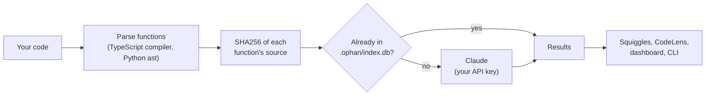

<p align="center">
  
</p>

<h1 align="center">Ophan</h1>

<p align="center">
  <strong>AI security review that lives in your editor.</strong><br>
  Ophan reads every function in your codebase with Claude, flags vulnerabilities on the exact line,<br>
  traces where user input and secrets flow, and documents everything. Local-first, bring your own key.
</p>

<p align="center">
  <a href="LICENSE"></a>
  <a href="https://github.com/Mikephii/ophanim/actions/workflows/ci.yml"></a>
  <a href="https://www.npmjs.com/package/@ophan/cli"></a>
  <a href="https://marketplace.visualstudio.com/items?itemName=ophan.ophan"></a>
  <a href="https://open-vsx.org/extension/ophan/ophan"></a>
</p>


https://github.com/user-attachments/assets/fccb5db0-c2d0-4927-8743-b74bcbe2cf03


## What it does

- **Finds security problems**: SQL injection, XSS, hardcoded secrets, command injection, path traversal, unsafe `eval` and deserialization, and more, each with an explanation and a fix, as a squiggle on the line that's wrong.
- **Traces data flow**: tags every function that touches user input, PII, credentials, the database, files or external APIs.
- **Documents your code**: a description, parameters and return value for every function, plus generated architecture docs.
- **Stays out of your way**: re-analyzes only the functions you change, in the background, as you save.

TypeScript, JavaScript and Python. VS Code and its forks (Cursor, Windsurf, VSCodium), or any terminal.

## Quickstart

**VS Code** (Node.js must be on your PATH):

1. Install **Ophan** from the [VS Code Marketplace](https://marketplace.visualstudio.com/items?itemName=ophan.ophan) or [Open VSX](https://open-vsx.org/extension/ophan/ophan), or grab a VSIX from [Releases](https://github.com/Mikephii/ophanim/releases). [All install options](docs/extension.md#install).
2. Add your [Anthropic API key](https://console.anthropic.com) under **Settings → Ophan**.
3. Click **Analyze Now**.

**Terminal** (Node.js 20+):

```bash
export ANTHROPIC_API_KEY=sk-ant-...
npx @ophan/cli init      # index your functions (local, no network)
npx @ophan/cli watch     # analyze, then re-analyze on every save
```

## See it work

### Analyze a workspace

One command analyzes every function; after that, watch mode keeps up as you save.

<!-- VIDEO 01-analyze.mp4 -->
https://github.com/user-attachments/assets/c8de8721-09b0-4fc8-b425-bf69a9262e1f

### Findings on the exact line

Each finding sits on the line that causes it, with severity, an explanation and how to fix it.

<!-- VIDEO 02-findings.mp4 -->
https://github.com/user-attachments/assets/743601e0-d727-4b2d-ae24-25e2ee8dcae2


### Fix it and it's gone

Edit a flagged line and its squiggle disappears immediately. Re-analysis confirms the fix a few seconds later. If the problem is still there, the squiggle comes back on the right line.

<!-- VIDEO 03-fix.mp4 -->
https://github.com/user-attachments/assets/19eccbf7-fc01-4f3e-8748-646262e710fc


### Follow the data

See which functions handle user input, PII and credentials, and where they go.

<!-- VIDEO 04-dataflow.mp4 -->
https://github.com/user-attachments/assets/dcbbe0b0-fc93-4e5f-b746-2e7ead6d2936


### Every function documented

CodeLens above each function; click for parameters, return value and findings.

<!-- VIDEO 05-docs.mp4 -->
https://github.com/user-attachments/assets/0743029d-e667-49cc-95a0-0e0f87d3f4a8


### The dashboard

Security posture and top issues inside the editor, then the architecture docs Ophan writes for your codebase (`ophan graph --summarize`).

<!-- VIDEO 06-dashboard.mp4 -->
https://github.com/user-attachments/assets/1700f7f8-0006-48a8-acca-4ad2a516e30c


### From the terminal

The same analysis from the CLI, for any editor or CI. Unchanged functions come straight from the cache.

<!-- VIDEO 07-cli.mp4 -->
https://github.com/user-attachments/assets/c4dc6329-6015-44c8-9e96-1ad7d4d5f003


## How it works



Results are stored by the hash of each function's source in `.ophan/index.db`, a SQLite file inside your repo (gitignored for you). The same function is never analyzed twice, whatever branch, file or position it's in, and editing a function re-analyzes just that function.

**Ophan would rather miss an issue than show you a wrong one.** Ambiguous findings come back as info, not warnings; a finding whose exact line can't be located isn't shown; and fixing a line clears its squiggle immediately. A tool that cries wolf gets ignored.

## Privacy and cost

- **Local-first.** Analysis results live in your repo's `.ophan/` folder. No account, no server, no telemetry.
- **Your key, your bill.** Ophan calls the Anthropic API with your key. For each function it hasn't seen before, it sends that function's name and source code (no file paths, no other files) and gets the analysis back. Nothing else leaves your machine.
- **Cheap after the first run.** On Ophan's own CLI source (10 files, 43 functions) the first analysis took 14 seconds and cost **$0.15** with `claude-sonnet-5-5`, about **$3.50 per 1,000 functions**. Running it again with no changes cost nothing. Pick another model with `OPHAN_MODEL`.

## Sync and the web dashboard (optional, self-hosted)

To share analysis across machines and teammates and get a browser dashboard, run your own Ophan server: Supabase plus one Docker container. Sync sends analysis results, never source code. See [docs/self-hosting.md](docs/self-hosting.md).

## In CI

```yaml
- uses: actions/cache@v4
  with: { path: .ophan, key: "ophan-${{ github.sha }}", restore-keys: ophan- }
- run: npx @ophan/cli analyze
  env: { ANTHROPIC_API_KEY: "${{ secrets.ANTHROPIC_API_KEY }}" }
```

With `.ophan/` cached, each run only pays for changed functions. Full example in [docs/cli.md](docs/cli.md#ci).

## Documentation

| | |
|---|---|
| [Getting started](docs/getting-started.md) | What Ophan does, first run |
| [VS Code extension](docs/extension.md) | Install options, settings, troubleshooting |
| [CLI](docs/cli.md) | Every command and flag, CI |
| [Security analysis](docs/security-analysis.md) | Flags, findings, data tags, priorities |
| [Self-hosting](docs/self-hosting.md) | Running your own sync server and dashboard |
| [All docs](docs/README.md) | Including architecture docs for contributors |

## Repository layout

| Path | What |
|---|---|
| `packages/core` | Analysis engine: parsers, content hashing, SQLite, Claude calls, function graph |
| `packages/cli` | `@ophan/cli`: analyze, watch, graph, sync |
| `packages/vscode` | The VS Code extension |
| `packages/webview` | The React panel shown inside the extension |
| `packages/webapp` | The self-hosted dashboard and sync server (TanStack Start) |
| `supabase/` | Database schema and migrations for the server |
| `deploy/` | Docker Compose and Caddy examples for self-hosting |
| `demo/` | The sample app and recording rig behind the videos above |
| `docs/` | User guides and architecture docs |

## Contributing

Bug reports, ideas and pull requests are welcome. Start with [CONTRIBUTING.md](CONTRIBUTING.md). Please report security vulnerabilities in Ophan itself privately, as described in [SECURITY.md](SECURITY.md).

## License

[MIT](LICENSE) © 2026 Michael Collins. Third-party licenses: [THIRD_PARTY_NOTICES.md](THIRD_PARTY_NOTICES.md).
