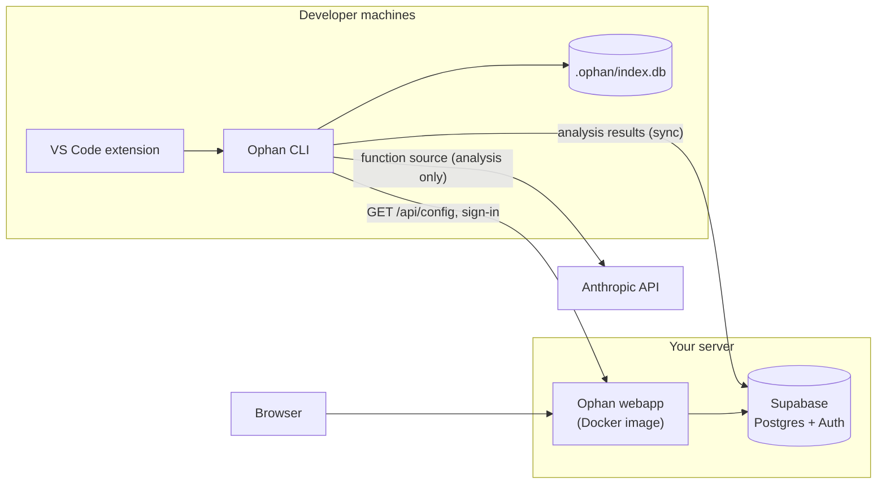

# Self-hosting an Ophan server

Ophan's analysis runs on your machine and needs no server: the CLI and the extension keep results in `.ophan/index.db` inside each repository. Run a server only if you want:

- **Sync**: analysis follows you across machines, and anyone on the same server pulls results instead of paying to re-analyze the same function.
- **The web dashboard**: security findings, function docs and architecture docs for every synced repo, in a browser.
- **Coding practices**: per-repo rules, managed in the dashboard, that analysis checks every function against (see [practices.md](practices.md)).

There is no hosted Ophan service. This guide sets up your own.

## What runs where



| Piece | What it does | You provide |
|---|---|---|
| Supabase | Postgres for synced analysis, Auth for accounts | A Supabase Cloud project, or self-hosted Supabase |
| Webapp | Dashboard, sign-in for the CLI, `/api/config` for clients | One Docker container (`packages/webapp/Dockerfile`) |
| CLI / extension | Analysis, sync | Each developer's own Anthropic API key |

**What the server stores.** Sync sends analysis results, never source code: per function, its content hash and the analysis JSON (description, parameters, security findings, data tags), plus its repo-relative file path, name and start line. It also stores the repo folder name and git remote URL, and the architecture docs from `ophan graph --summarize`. Function source only ever goes from the developer's machine to the Anthropic API, using their key.

## Requirements

- Docker (for the webapp)
- A Supabase project: [Supabase Cloud](https://supabase.com) (the free tier is enough to start) or [self-hosted Supabase](https://supabase.com/docs/guides/self-hosting/docker)
- The [Supabase CLI](https://supabase.com/docs/guides/local-development/cli/getting-started), to apply the database schema
- A domain and TLS for anything beyond a single machine (the CLI sends session tokens to the server)

## Step 1: Supabase

Pick one:

**A. Supabase Cloud (easiest).** Create a project. From **Project Settings → API**, note the project URL, the `anon` key and the `service_role` key.

**B. Self-hosted Supabase.** Follow Supabase's [Docker self-hosting guide](https://supabase.com/docs/guides/self-hosting/docker). Note the API URL (Kong, port 8000 by default), `ANON_KEY` and `SERVICE_ROLE_KEY` from its `.env`.

**C. Just trying it out.** From a clone of this repo, `supabase start` runs a local stack and applies the schema for you (skip step 2). `supabase status` prints the URL and keys.

## Step 2: Apply the database schema

The schema lives in `supabase/migrations/` (tables, row-level security policies, and a trigger that creates a profile row for each new account).

For Supabase Cloud, from a clone of this repo:

```bash
supabase login
supabase link --project-ref <your-project-ref>
supabase db push
```

For self-hosted Supabase, point `db push` at its Postgres:

```bash
supabase db push --db-url "postgresql://postgres:<password>@<db-host>:5432/postgres"
```

Every table has row-level security on, scoped to the signed-in user, so the anon key handed to clients only reaches each user's own rows.

## Step 3: Auth settings

In Supabase (**Authentication → URL Configuration** on Cloud, or `config.toml` / env vars when self-hosted):

- **Site URL**: your webapp's URL, e.g. `https://ophan.example.com`
- **Redirect URLs**: add the same URL

Ophan signs people in with email and password. Decide how accounts get created:

- **Email confirmation.** On by default in Supabase Cloud. Configure SMTP (**Authentication → Emails → SMTP**) so confirmation mails arrive, or turn **Confirm email** off for a private server.
- **Closed sign-ups.** To stop strangers creating accounts, create your team's accounts first (**Authentication → Users → Add user**), then turn off **Allow new users to sign up** (self-hosted: `DISABLE_SIGNUP=true` in Supabase's `.env`; local: `[auth] enable_signup = false` in `supabase/config.toml`).

CLI sign-in needs no extra redirect URL: the webapp hands the CLI a one-time token over `http://localhost:<port>/callback`, which the CLI opens on the developer's machine.

## Step 4: Run the webapp

```bash
git clone https://github.com/Mikephii/ophanim.git && cd ophanim
cp deploy/.env.example deploy/.env
# edit deploy/.env: SUPABASE_URL, SUPABASE_ANON_KEY, SUPABASE_SERVICE_ROLE_KEY
docker compose -f deploy/docker-compose.yml up -d
curl http://localhost:3000/api/health   # ok
curl http://localhost:3000/api/config   # {"supabaseUrl": "...", "supabaseAnonKey": "..."}
```

`deploy/docker-compose.yml` builds the image from the checkout. Tagged releases also publish `ghcr.io/mikephii/ophan-webapp:<version>`; swap `build:` for `image:` in the compose file to use one.

All configuration is read when the container starts, so one image works for any server:

| Variable | Required | Meaning |
|---|---|---|
| `SUPABASE_URL` | yes | How the webapp reaches Supabase |
| `SUPABASE_ANON_KEY` | yes | Public anon key, also handed to browsers and the CLI |
| `SUPABASE_SERVICE_ROLE_KEY` | yes | Used server-side only, to mint CLI sign-in tokens. Never share it. |
| `SUPABASE_PUBLIC_URL` | no | The Supabase URL browsers and CLIs should use, when it differs from `SUPABASE_URL` (e.g. the webapp reaches Supabase over a Docker network name) |
| `OPHAN_PORT` | no | Host port (compose only, default `3000`) |

### TLS

Put a reverse proxy in front. With [Caddy](https://caddyserver.com), `deploy/Caddyfile.example` is the whole config:

```
ophan.example.com {
	reverse_proxy 127.0.0.1:3000
}
```

## Step 5: Connect clients

**CLI** (once per machine):

```bash
npx @ophan/cli login --server https://ophan.example.com
npx @ophan/cli sync            # pull + push for the current repo
npx @ophan/cli watch --sync    # analyze on save and sync as you go
```

`login --server` fetches `/api/config`, saves the server in `~/.ophan/config.json`, opens the browser to sign in, and stores the session in `~/.ophan/credentials.json`. Later commands use the saved server.

**VS Code extension.** Set **Ophan: Server Url** (`ophan.serverUrl`) to `https://ophan.example.com`, then run **Ophan: Sign In**. With `ophan.autoSync` on (the default), the extension syncs after each analysis. With no server URL set, the extension never prompts you to sign in and stays fully local.

**CI.** Analysis in CI needs only `ANTHROPIC_API_KEY`. Syncing from CI also needs a signed-in session in `~/.ophan/credentials.json` on the runner (sign-in is a browser flow today, so this suits long-lived self-hosted runners). These variables override which server the CLI talks to:

| Variable | Meaning |
|---|---|
| `OPHAN_SERVER_URL` | Server to use instead of the saved one (Supabase settings come from its `/api/config`) |
| `OPHAN_SUPABASE_URL` + `OPHAN_SUPABASE_ANON_KEY` | Use this Supabase directly, without asking the webapp |


## Upgrading

1. Pull the new code (or bump the image tag).
2. Apply new migrations: `supabase db push` (as in step 2). Migrations only move forward; take a backup first.
3. `docker compose -f deploy/docker-compose.yml up -d --build`.

Read [CHANGELOG.md](../CHANGELOG.md) before upgrading, and upgrade the server before (or with) the CLI and extension.

## Backups

Everything the server knows lives in Supabase's Postgres. Supabase Cloud has daily backups on paid plans; otherwise run `pg_dump` on a schedule. Analysis is also recoverable from any developer's `.ophan/index.db` by running `ophan sync` again, since sync is content-addressed and insert-only.

## Troubleshooting

| Symptom | Cause and fix |
|---|---|
| `No Ophan server configured` | Expected when no server is set. Run `ophan login --server <url>` or set `ophan.serverUrl`. Analysis itself never needs a server. |
| `Cannot reach the Ophan server at ...` | Wrong URL, server down, or TLS problem. Try `curl <url>/api/health`. |
| `/api/config returned 503`, or pages show "Ophan server is not configured" | The container is missing the variables the message names (`SUPABASE_URL`, `SUPABASE_ANON_KEY`, `SUPABASE_SERVICE_ROLE_KEY`). `/api/health` still answers so the container stays healthy while you fix it. |
| Sign-in page loops back to sign-in | Browsers can't reach the Supabase URL the webapp hands them. Set `SUPABASE_PUBLIC_URL` to an address browsers can reach. |
| `Session expired or invalid` | Run `ophan logout` then `ophan login`. Switching servers always needs a fresh sign-in. |
| Sign-up email never arrives | Configure SMTP or turn off email confirmation (step 3). |
| `supabase db push` reports drift | Someone changed the schema by hand. Compare with `supabase db diff` before pushing. |
